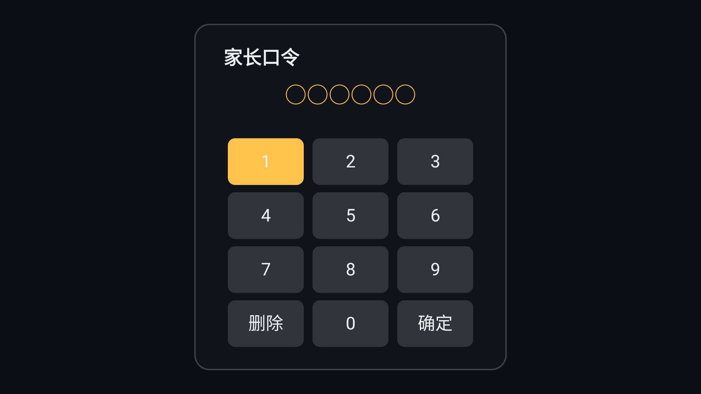
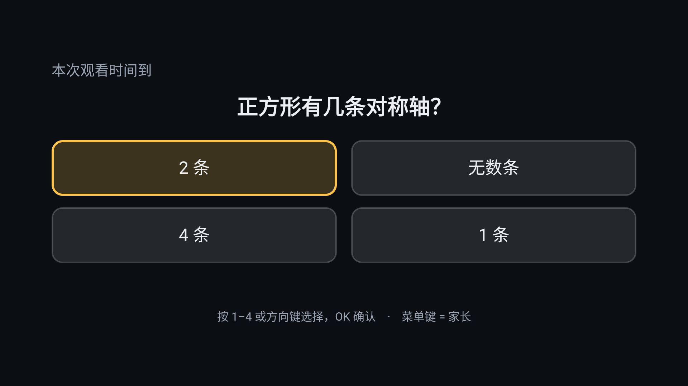
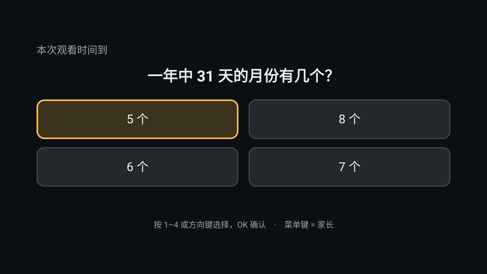

# 答对再看 · QuizGate

**到点出一题，答对换 N 分钟。** 给中国电视（小米为主）用的「续时闸门」，不是家长控制软件，也不是儿童锁。

<p align="center">
  
  
  
</p>

> 截图均为实机拍摄：小米电视 MiTV-MFTR0 / Android 11 (API 30) / 1920×1080

---

## 它解决什么问题

孩子看电视没有「结束」这个动作。你说"再看 30 分钟"，实际执行全靠自觉。

这个应用把时间变成一个**看得见的交易**：

1. 家长设 30 分钟，点开始；
2. 孩子随便看，最后 30 秒右下角读秒；
3. 到点全屏出题，答对 +N 分钟，接着看；
4. 家长用 6 位口令结束本次会话。

它不做的事比做的事更多——见下面的「它不做什么」。

---

## 三条硬事实（装之前请先读）

1. **必须用电脑执行两条 adb 命令**，否则守护不生效。小米电视固件把「显示在其他应用上层」和「通知使用权」的 UI 入口藏了，只能用 adb 开。
2. **只在小尺寸范围内验证过**：1 台机型、7 类证据。见 [兼容性矩阵](docs/compatibility.md)，未测的机型一律标「未验证」。
3. **它防不住卸载**。这是 Android 的设计，任何第三方应用都防不住。

---

## 10 分钟装好

### 0. 前提

- 电视：Android 8.0+（API 26+），小米电视 / Android TV / 电视盒子
- 电脑：装有 `adb`（macOS/Linux/Windows 均可）
- 电视与电脑在同一局域网，且电视已开启「网络调试」或插着 USB

### 1. 装 APK

从 [Releases](https://github.com/mtvtopcom/quizgate-tv/releases) 下载最新的 `quizgate-x.y.z.apk`，校验 SHA-256 后安装：

```bash
adb connect <电视IP>:5555
adb install -r quizgate-1.0.0.apk
```

也可以用 U 盘装（见下方「安装路径 A」）。

### 2. 授权（关键，缺一不可）

```bash
# ① 显示在其他应用上层：遮罩要靠它
adb shell appops set app.quizgate.tv SYSTEM_ALERT_WINDOW allow

# ② 通知使用权：强停/重启后靠它把应用拉回来
adb shell cmd notification allow_listener app.quizgate.tv/app.quizgate.tv.NotifProbe

# 验证
adb shell appops get app.quizgate.tv SYSTEM_ALERT_WINDOW     # 应输出 allow
adb shell settings get secure enabled_notification_listeners # 应包含 app.quizgate.tv/...
```

### 3. 设口令、开始

1. 打开**答对再看** → 设 6 位口令（输两遍）
2. 「本次时长」选 **1 分钟**（第一次别用 30 分钟，等不起）
3. 点「开始计时」→ 回桌面看视频
4. 60 秒后应出现读秒和遮罩，按 1–4 作答
5. 想结束：遮罩上按**菜单键** → 输口令

> **口令是你自己设的，安装包里没有任何默认口令。**
>
> | 场景 | 会看到什么 |
> | --- | --- |
> | 第一次装、或卸载后重装 | 直接是「设置 6 位家长口令」，输两遍，随即弹出新的恢复码 |
> | 覆盖升级到新版 | 口令、恢复码、时长、年级全部沿用，只需输入原来的口令 |
>
> 口令和恢复码只以 PBKDF2 哈希存在这台电视的 `SharedPreferences` 里，不打包进 APK、
> 不上传、也没有「出厂口令」。`allowBackup="false"`，卸载重装不会从系统备份里捞回旧口令。

---

## 安装路径 A：U 盘（不需要电脑装 adb）

1. 把 APK 拷到 U 盘根目录（FAT32）
2. U 盘插电视 → 电视管家 / 文件管理 → 找到 APK → 安装
3. 若提示「禁止安装未知来源」：设置 → 账号与安全 → 允许安装未知来源应用
4. 装完后**仍然需要执行上面第 2 步的两条 adb 命令**，否则遮罩出不来

---

## 兼容性矩阵

| 机型 | 系统 | 桌面 | 悬浮窗 | 按 HOME | 电源键 | 重启接续 |
| --- | --- | --- | --- | --- | --- | --- |
| 小米电视 MiTV-MFTR0 | Android 11 (API 30) / OS2.0.5.0.RFTMATV | `com.mitv.tvhome` | ✅ | ✅ 遮罩保持焦点 | ✅ 强停后 150ms 复活 | ✅ 实测 |
| 其他机型 | — | — | 未验证 | 未验证 | 未验证 | 未验证 |

原始取证命令与输出见 [docs/compatibility.md](docs/compatibility.md)。**未验证的格子不许当成结论**，这是这个项目的规矩。

---

## 常见故障

| 现象 | 原因 | 怎么做 |
| --- | --- | --- |
| 装了没反应，到点不出题 | 悬浮窗权限没给 | `adb shell appops get app.quizgate.tv SYSTEM_ALERT_WINDOW`，应输出 `allow` |
| 遮罩出来了，遥控器没反应 | 窗口焦点被系统对话框抢走 | 按一下电源键再开；仍无效请看 `adb logcat -s QuizGate` 里有没有 `mask_add ok` |
| 按 HOME 回到桌面，遮罩不见了 | 悬浮窗权限被系统回收 | 重新执行授权命令① |
| 按电源键关了电视，再开没有守护 | 「通知使用权」没给 | 执行授权命令② |
| 关屏时电视自己亮了 | 旧版本问题（v1.0.0 已修） | 升级到 1.0.0+ |
| 读秒小窗压在提示文字上 | v0.1.3 之前的 bug | 升级 |
| 家长忘了口令 | — | 用恢复码重置（设置页「忘记口令？」）。见 [恢复路径](docs/recovery.md) |
| `INSTALL_FAILED_UPDATE_INCOMPATIBLE` | 签名不一致 | 先 `adb uninstall app.quizgate.tv` 再装 |
| 开机后应用不见了 | 小米重启会清空第三方应用状态 | 正常现象；通知监听会在开机时把进程拉回来 |
| 提示「守护已停止（安全模式）」 | 连续 3 次启动崩溃触发了熔断 | 设置页 →「守护状态」→ 恢复守护。这不是故障，是故意不让电视反复闪屏 |
| 升级页显示「下载失败」 | 电视没网 / 升级源不可用 | 不影响使用（检查失败会静默跳过）；确认升级源地址后再进应用 |
| 点「立即安装」提示要去授权 | 没给「安装未知应用」权限（重装应用会重置） | 设置 → 应用 → 安全 → 安装未知应用 → 允许；回来再点「立即安装」，包已经下好了 |
| 点「立即安装」没反应 | 电视固件改过安装器入口 | 包就在 `Download/quizgate-x.y.z.apk`，用「媒体中心 / 文件管理」打开它 |

---

## 它不做什么

1. **不做每日总时长上限**。只做「这一次」。
2. **不防卸载**。只有 Device Owner 能限制卸载，那要求恢复出厂，家庭场景不可接受。
3. **不看内容**。不监听播放了什么，不读通知内容，不读屏幕文字。
4. **不收集数据，只在升级时联网**。v1.2.0 为在线升级引入了 `INTERNET`，所以「没有网络权限」这句
   在 1.1 及之前成立、现在不再成立，别拿旧说法当依据。可以验证的部分是：全部出网点在
   `Updater.java` 里只有两处（GET 一个 `version.json`、GET 那个 APK），
   请求不带参数、不带 cookie、不带设备信息（UA 固定写死成 `QuizGate`，不上报系统版本和机型）。
   升级源默认就是生产目录 `https://shitang.mianmiangou.cn/static/quizgate-tv/`；
   用 `QUIZGATE_UPGRADE_BASE=` 空值构建时，一次请求都不发。
   出网之外的行为没有变：不采集、不上报、不读屏幕内容。
5. **不做多孩子档案**、不做远程控制、不做手机 App。
6. **不是儿童锁**。它提高「白看」的成本，不提供不可绕过的保证。
7. **不接管桌面**。卸载后电视完全恢复原样。

---

## 为什么需要这两条权限

| 权限 | 用途 | 不授予的后果 |
| --- | --- | --- |
| `SYSTEM_ALERT_WINDOW`（显示在其他应用上层） | 全屏遮罩与右下角读秒 | 到点不会出题，计时等于没开 |
| 通知使用权（`NotificationListenerService`） | **只作为存活锚点**：系统重新绑定它时会把进程拉回来 | 按电源键/被强停后守护消失，孩子可以随便看 |

通知监听**不读取通知标题或正文**，代码里只用包名做存活判断（`NotifProbe.java`）。

---

## 恢复路径

- **忘口令**：用恢复码重置（设置页「忘记口令？」，或遮罩上按菜单键后的口令面板里）。恢复码照片也丢了才需要卸载重装，设置与题库状态会丢失（`allowBackup=false`）。
- **遮罩卡死**：长按 OK 10 秒 → 仍无响应 → 电源键熄屏 10 秒再唤醒 → 仍无响应 → 拔电源重启。
- **开机循环**：v1.2.0 起有崩溃熔断——连续 3 次启动崩溃后自动停止挂遮罩，不会再循环闪屏。
  到设置页「守护状态」可手动恢复，那里的崩溃信息请一并反馈。

详见 [docs/recovery.md](docs/recovery.md)。

---

## 构建

不需要 Gradle，不需要联网拉依赖：

```bash
# 需要 JDK 17 与 Android SDK（build-tools 35 + platform 35）
export ANDROID_HOME=/path/to/android-sdk
./build.sh            # 调试包（debug 签名）
./build.sh release    # 发布包（需要 keystore/release.jks 与 keystore/release.pass）
```

产物在 `build/`。构建链是 `aapt2 → javac → d8 → zipalign → apksigner`，每一步可见，没有插件黑箱。

---

## 许可

- **代码**：[Apache-2.0](LICENSE)（含显式专利授权）
- **题库内容**：[CC BY-SA 4.0](LICENSE-CONTENT)，与代码分开授权，作为独立作品聚合

题库为原创，不含教材原文。素材来源见 [docs/provenance.md](docs/provenance.md)。

---

## 签名

本项目的 APK 由固定的发布密钥签名，指纹如下（升级必须一致）：

```
证书 SHA-256: 06:12:E6:31:8D:4C:AB:A8:70:A1:16:B5:64:40:2E:15:12:D3:2C:FB:14:60:73:08:1B:07:BD:F2:8F:8E:3C:B8
```

> 早期调试包用的是 `keystore/debug.keystore`（另一把钥匙，指纹 `BD:46:13:…`）。
> 两者不能互相覆盖：装过调试包的电视要换正式包，必须先卸载一次（会丢口令和设置）。
> v1.2.3 起客户端会在安装前比对签名，不一致直接拦下并说明原因。

每个 Release 附 `SHA256SUMS.txt`，可自行比对：

```bash
shasum -a 256 quizgate-1.0.0.apk
```
